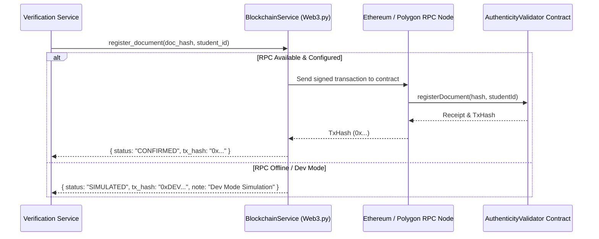

# Authentication Validator - Blockchain Architecture & Design

## Overview
The blockchain layer provides a **tamper-proof decentralized trust layer** for academic credentials. By recording cryptographic document hashes (`bytes32` SHA-256) on-chain alongside issuer addresses and timestamps, certificates become universally verifiable without relying on a centralized intermediary.

---

## Smart Contract Specification (`AuthenticityValidator.sol`)

### Contract Attributes
- **Solidity Version**: `^0.8.20`
- **License**: `MIT`
- **Network Compatibility**: Ethereum, Polygon, Arbitrum, Binance Smart Chain, and Local Ganache / Hardhat.

### Data Structures
```solidity
struct DocumentRecord {
    bytes32 documentHash;     // SHA-256 Hash of original document file
    string studentId;         // Identifier / Roll number of student
    address issuerCollege;     // Ethereum address of issuing college
    uint256 issuanceTimestamp; // Epoch timestamp of registration
    bool isRevoked;           // Revocation flag for invalidation
    bool exists;              // Existence flag
}
```

### Key Functions
- `registerDocument(bytes32 _docHash, string calldata _studentId)`:
  - Caller must be an authorized college or contract admin.
  - Checks if `_docHash` is already registered to prevent duplicates.
  - Emits `DocumentRegistered(_docHash, _studentId, msg.sender, block.timestamp)`.
- `verifyDocument(bytes32 _docHash)`:
  - View function returning `(bool exists, string memory studentId, address issuer, uint256 timestamp, bool isRevoked)`.
  - Emits `DocumentVerified(_docHash, msg.sender, block.timestamp)`.
- `revokeDocument(bytes32 _docHash, string calldata _reason)`:
  - Callable by the original issuing college to revoke forged or disputed records.
  - Emits `DocumentRevoked(_docHash, msg.sender, _reason)`.

---

## Web3 Integration & Fallback Strategy

The backend communicates with the smart contract using `backend/blockchain/blockchain_service.py` via `Web3.py`.



### Zero-Downtime Resilience
If a local Ganache instance or testnet RPC is unavailable, the `BlockchainService` automatically logs the SHA-256 fingerprint into the local database ledger while generating a deterministic transaction signature so the verification pipeline remains 100% operational during development and offline testing.
