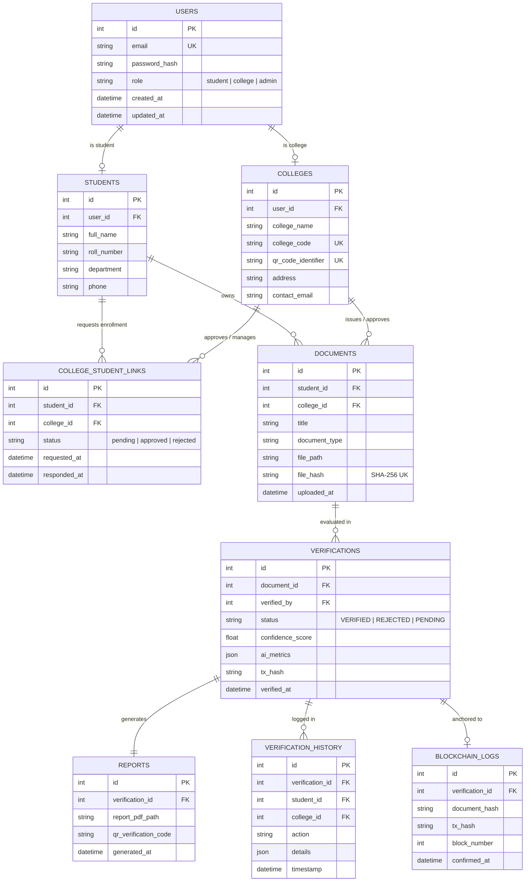

# Authentication Validator - Database Design & Schema

## Database Architecture
The platform is designed to run seamlessly on both **MySQL 8.0+** (production enterprise grade) and **SQLite 3** (local developer zero-config mode) via SQLAlchemy ORM.

---

## Entity Relationship (ER) Diagram

---

## Integrity & Preservation Rules
1. **Immutable History**: Historical verification logs (`VERIFICATION_HISTORY`) retain college and student snapshot IDs regardless of subsequent enrollment status updates or disaffiliations.
2. **Deterministic Document Fingerprint**: `DOCUMENTS.file_hash` is computed using raw binary SHA-256. If a duplicate hash is uploaded, the existing document record is referenced to prevent duplicate processing.
3. **Audit Trail**: Every verification result snapshot is preserved in `REPORTS` with an immutable PDF path and QR checksum.
